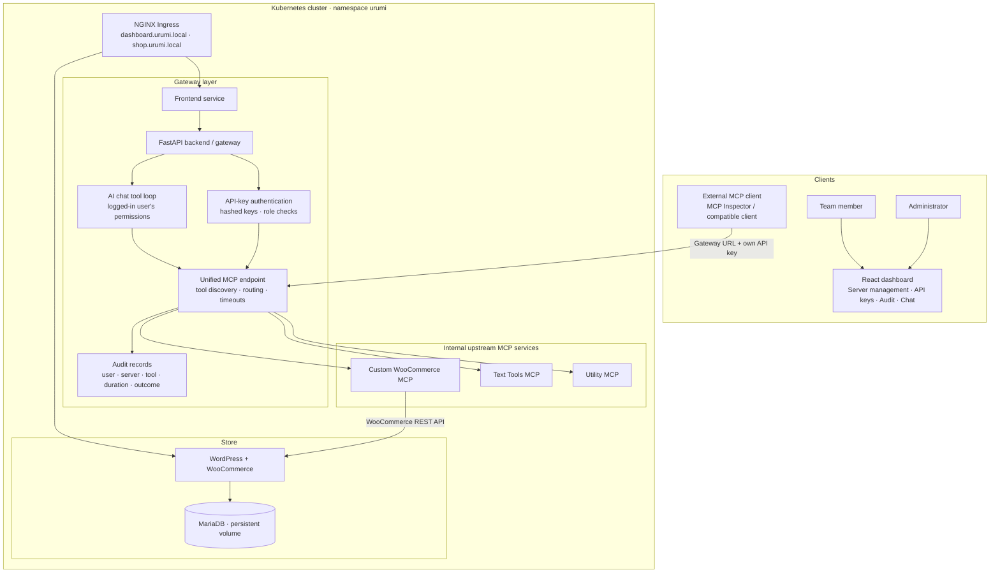

# Urumi MCP Gateway

**Urumi AI FDE Internship — Round 1: MCP Gateway on Kubernetes**

A Kubernetes-hosted WooCommerce demo with a custom WooCommerce MCP server, a unified MCP gateway, a React dashboard, role-based access, revocable API keys, audit logging, and an AI chat interface.

> **Accuracy note:** This README separates the local environment that has been tested from production/VPS steps that still require environment-specific configuration. Do not treat a Helm template render as proof that a production deployment has been completed.


## Contents

- [Overview](#overview)
- [Architecture](#architecture)
- [Features and assignment coverage](#features-and-assignment-coverage)
- [Repository structure](#repository-structure)
- [Prerequisites](#prerequisites)
- [Run the existing local deployment](#run-the-existing-local-deployment)
- [Open the applications](#open-the-applications)
- [End-to-end demo](#end-to-end-demo)
- [MCP tools and routing](#mcp-tools-and-routing)
- [External MCP client](#external-mcp-client)
- [API overview](#api-overview)
- [Kubernetes and Helm](#kubernetes-and-helm)
- [Fresh local installation](#fresh-local-installation)
- [Production/VPS deployment (k3s)](#productionvps-deployment-k3s)
- [Tests and validation](#tests-and-validation)
- [System design and trade-offs](#system-design-and-trade-offs)
- [Threat model and security](#threat-model-and-security)
- [Troubleshooting](#troubleshooting)
- [Demo video checklist](#demo-video-checklist)
- [Known limitations and next steps](#known-limitations-and-next-steps)

## Overview

Urumi provides one gateway endpoint for tools from multiple Model Context Protocol (MCP) servers. The gateway authenticates clients, applies user permissions, exposes tools from enabled upstream servers, routes tool calls, and records audit events.

The WooCommerce MCP server is custom-built for this project and communicates with the WooCommerce store through its REST API. Text Tools and Utility are additional upstreams used to demonstrate aggregation and failure isolation. The React dashboard provides server/key management, audit views, and a chat agent that invokes tools through the gateway.

## Architecture



**Request flow:** a dashboard or external client sends a request to the gateway with its own gateway API key. The backend validates the key and role, discovers the tools available to that user, routes an allowed tool call to the corresponding internal MCP server, and records the result. The WooCommerce MCP server then calls the store's REST API. Upstream credentials remain server-side and are not sent to the browser or external MCP client.

## Features and assignment coverage

| Assignment requirement | Implementation / evidence |
|---|---|
| WordPress + WooCommerce and database in Kubernetes | WordPress/WooCommerce and MariaDB workloads in the `urumi` namespace |
| Custom WooCommerce MCP server | `woo-mcp-server`; five product/order tools |
| Three upstream MCP servers | WooCommerce, Text Tools, Utility |
| Unified MCP endpoint | Backend gateway aggregates enabled upstream tools |
| Admin/member access | Role checks; administrative actions restricted |
| Hashed, revocable API keys | API-key creation/list/revocation endpoints |
| Audit trail | Tool calls include user, server, tool, timestamp, duration, outcome and error information |
| Dashboard and chat | React dashboard; chat agent calls tools through gateway and shows tool activity |
| Local Kubernetes and Helm | Kind local environment; Helm chart and local/prod values files |
| Ingress | `dashboard.urumi.local` and `shop.urumi.local` |
| Persistence | WordPress and MariaDB persistent storage configured in the store chart |
| Failure isolation | Tested that Text Tools and WooCommerce continued working while Utility was scaled to zero |
| External-client demo, dead-pod dashboard status, complete fresh install, production VPS | Follow the test/limitation notes below; do not claim these are verified unless demonstrated in your environment |

## Repository structure

```text
.
├── backend/                  # FastAPI backend, gateway, auth, chat, audit
├── frontend/                 # React dashboard and frontend Dockerfile
├── woo-mcp-server/           # Custom WooCommerce MCP server
├── text-tools-mcp/           # Text utility MCP server
├── utility-mcp/              # Utility MCP server
├── k8s/                      # Kubernetes manifests used by local setup
├── helm/
│   ├── woo-platform/         # Store chart (WordPress/WooCommerce/MariaDB)
│   ├── gateway/              # Gateway/dashboard and MCP workloads chart
│   └── values/
│       ├── values-local.yaml
│       └── values-prod.yaml
├── tests/                    # Backend automated tests
├── test_audit.py             # Audit smoke test
├── test_unified_mcp.py       # Unified MCP smoke test
└── README.md
```

Names may vary slightly as the project evolves. Check the actual directories in the checked-out repository before running commands that reference a specific path.

## Prerequisites

For local development on Windows:

- Docker Desktop with Kubernetes/Kind support as used by your setup
- `kubectl`
- `helm`
- Git
- Python and Node.js only if running tests/builds outside the container
- A local model runtime such as Ollama and the configured model if you want to use the AI chat

Verify the command-line tools in **Windows Command Prompt (CMD)**:

```cmd
docker version
kubectl version --client
helm version
git --version
```

For a fresh clone:

```cmd
git clone https://github.com/nihells/urumi-mcp-gateway.git
cd urumi-mcp-gateway
```

Do not commit credentials, API keys, local login files, `.env` files, or generated key files. Use Kubernetes Secrets or your deployment's secret-management mechanism.

## Run the existing local deployment

These instructions are for the local Kind environment that was previously tested. They check and open the deployment; they do not create a complete new cluster from scratch.

### 1. Start Docker Desktop

Wait until Docker Desktop is running. Then open CMD in the repository directory:

```cmd
cd C:\Users\nihel\urumi-mcp-gateway
docker info
```

If `docker info` fails, resolve the Docker Desktop/daemon issue before continuing.

### 2. Check the cluster and workloads

```cmd
kubectl config current-context
kubectl get nodes
kubectl get pods -n urumi
kubectl get deployments -n urumi
kubectl get services -n urumi
kubectl get ingress -n urumi
```

The local context used for this project is `kind-urumi-local`. The cluster should have a Ready node and the main deployments should show `1/1` ready (the frontend may be configured for a different replica count by environment).

Expected workloads include `urumi-backend`, `urumi-frontend`, `woo-mcp-server`, `text-tools-mcp`, `utility-mcp`, `urumi-wordpress`, and `urumi-mariadb`. If they are absent, this is not an already-deployed environment; use the fresh-install notes and verify the chart/manifests first.

### 3. Open the applications

The local hosts must resolve to the Ingress controller. In the tested Windows environment these URLs worked:

- Dashboard: <http://dashboard.urumi.local>
- Storefront: <http://shop.urumi.local>

If either name does not resolve, inspect the Ingress controller address and Windows hosts/DNS setup:

```cmd
kubectl get ingress -n urumi
kubectl get svc -n ingress-nginx
kubectl get pods -n ingress-nginx
```

The exact hosts-file entry depends on how the Ingress controller is exposed by your Docker Desktop/Kind setup. Do not copy an IP from another machine; use the address that applies to your environment. If needed, run CMD as Administrator to edit `C:\Windows\System32\drivers\etc\hosts`, and map the two hostnames to the correct local Ingress address.

### 4. Check backend health

In one CMD window:

```cmd
kubectl port-forward -n urumi service/urumi-backend 8010:8001
```

Keep that window open. In another CMD window:

```cmd
curl http://127.0.0.1:8010/health
```

Expected result is a healthy status response. Stop the port-forward with `Ctrl+C` when finished.

## Open the applications

### Dashboard

Open <http://dashboard.urumi.local>. Sign in using an administrator or member account that you have provisioned in your environment. Do not place passwords or API keys in this README.

The dashboard is intended for managing upstream servers and API keys, viewing audit events as an administrator, and using the AI chat. Available actions depend on the signed-in user's role.

### Storefront and checkout

Open <http://shop.urumi.local>. To demonstrate checkout:

1. Open a product page and add a product to the cart.
2. Go to the cart and proceed to checkout.
3. Enter test customer details and choose the test-friendly payment method configured for the store (for example, Cash on Delivery if enabled).
4. Place the order.
5. Open WordPress/WooCommerce administration and confirm that the order exists.

Use test data only. Do not enter real payment-card information into a demo store.

## End-to-end demo

Run this checklist against the live deployment and capture actual results for the submission video.

### A. Store and order

1. Open the storefront and complete a test checkout.
2. Confirm the new order appears in WooCommerce administration.
3. Note the order number and products for the chat test.

### B. Chat agent as an administrator

1. Sign in as the administrator.
2. Ask the chat agent to create a product with a unique name and price.
3. Confirm the product exists in WooCommerce and is visible on the storefront.
4. Place a test order for that product.
5. Ask: **“What orders came in today?”**
6. Confirm the answer includes the new order and that the chat UI shows the tools used.

### C. External MCP client as a member

1. Create a separate member API key from the dashboard/API.
2. Connect an MCP client using the gateway endpoint and that member's key only.
3. List tools and confirm tools from enabled upstream servers are available, subject to member permissions.
4. Ask the same today's-orders question.
5. Run a task that uses tools from two different upstream servers.
6. Revoke the member key and verify the next request is rejected.

The external client walkthrough must be tested with the actual client version and gateway URL you use. Do not paste a real key into the repository, video description, or screenshots.

### D. Server control and resilience

1. Disable an upstream from the dashboard and confirm its tools disappear from discovery and cannot be called.
2. Re-enable it.
3. Scale one upstream deployment to zero in a test environment and verify the other upstreams still answer calls.
4. Check whether the dashboard reports the stopped server as unreachable. Record this as unverified if the UI does not show the expected status.
5. Confirm tool calls appear in the audit log under the correct user.

To restore a deployment scaled to zero:

```cmd
kubectl scale deployment utility-mcp -n urumi --replicas=1
kubectl get deployments -n urumi
```

Only use the scale command when `utility-mcp` is the deployment you intentionally stopped.

## MCP tools and routing

The custom WooCommerce MCP server exposes these required operations:

| Tool purpose | Description |
|---|---|
| List products | Retrieve products from WooCommerce |
| Create product | Create a product (permission-restricted) |
| List orders | Retrieve orders, including today's orders when requested with the appropriate date range |
| Get order | Retrieve a particular order |
| Update order status | Update an order status (permission-restricted) |

The additional upstreams provide text and utility tools. Exact tool names and input schemas should be discovered from the live gateway using `tools/list`; names are prefixed/namespaced by upstream to avoid collisions (for example, `woocommerce__create_product`). Use the live tool schema rather than guessing parameter names.

### WooCommerce integration choice

The custom WooCommerce MCP server communicates with the store using the WooCommerce REST API. This keeps store operations behind the internal MCP service and avoids requiring the gateway or browser to hold WooCommerce credentials. Configure the REST API credentials through Kubernetes Secrets/environment configuration, not in source control.

### Tool routing and collisions

The gateway combines tools from enabled upstream servers and routes calls to the upstream that owns the selected tool. Namespacing tool names by server avoids ambiguous collisions when different servers expose the same original name. The dashboard and external client should use the names returned by the gateway rather than assuming an upstream tool name.

### Timeouts and upstream failure

Upstream calls should have bounded timeouts and clear errors. A failing upstream should not prevent calls to healthy upstreams. The tested smoke scenario scaled Utility to zero while Text Tools and WooCommerce remained usable. The exact dead-server status shown by the dashboard should be verified live before claiming it in the demo.

## External MCP client

The gateway MCP endpoint used during local testing is:

```text
http://127.0.0.1:8010/mcp/
```

This URL assumes the backend port-forward from the earlier section is running. For a client running inside the cluster, use the backend Service DNS/port and the correct MCP path configured by the application. For an external client running on the host, keep the port-forward open.

The gateway expects the gateway API key in the authentication header configured by this project. Check the API/client implementation and use the same header format for your MCP client; do not send WooCommerce upstream credentials to the client. The tested raw HTTP request used a bearer/API-key authentication header and accepted both JSON and server-sent event responses (`Accept: application/json, text/event-stream`).

If your MCP client supports a Streamable HTTP server configuration, set its server URL to the endpoint above and configure the gateway API key using the client's supported header/environment-secret mechanism. **Do not commit a populated client configuration file.** Exact configuration syntax differs between MCP clients and versions; validate it against the documentation for the client you actually use.

Verify the connection by listing tools, then call a permitted read-only tool such as listing products or orders. A revoked key should fail authentication. A member attempting a restricted administrative tool should be denied.

## API overview

The backend exposes HTTP APIs for health, authentication, API-key administration, upstream/server management, audit records, chat, and the MCP endpoint. Endpoint names and request schemas can change; inspect the router definitions or API docs in the running backend before writing client automation.

Useful local checks while the port-forward is running:

```cmd
curl http://127.0.0.1:8010/health
```

The MCP endpoint is `/mcp/`. MCP requests should use the protocol's expected JSON/SSE accept headers and the gateway's authentication header. The project includes `test_audit.py` and `test_unified_mcp.py` as smoke-test scripts; review their required environment variables before running them and provide credentials securely via environment variables or a local ignored file.

## Kubernetes and Helm

### Current chart layout

- `helm/woo-platform`: the existing store chart for WordPress/WooCommerce and MariaDB.
- `helm/gateway`: a chart template set for the gateway, dashboard, and MCP workloads.
- `helm/values/values-local.yaml`: local configuration.
- `helm/values/values-prod.yaml`: production-like configuration template.

Helm is mandatory for the assignment. Validate charts and inspect rendered resources before installing or upgrading:

```cmd
helm lint helm\woo-platform
helm lint helm\gateway
helm template urumi-gateway helm\gateway --namespace urumi -f helm\values\values-local.yaml
helm template urumi-gateway helm\gateway --namespace urumi -f helm\values\values-prod.yaml
```

A successful `helm template` only confirms that templates render; it does not deploy or validate a live cluster.

### Important ownership warning

The current local cluster already contains manually applied gateway-related resources in the `urumi` namespace, while the separate `helm/gateway` chart renders resources with overlapping names. **Do not run `helm install` or `helm upgrade` for `urumi-gateway` into that existing namespace without first planning and validating a migration.** Helm can fail because existing objects are not owned by the release, or an unsafe migration can disrupt a working demo. Use a clean test cluster/namespace for a first installation, and adapt chart values/names so resources do not collide with the store release.

### What to inspect in every workload

```cmd
kubectl get deployments -n urumi
kubectl get pods -n urumi
kubectl describe deployment urumi-backend -n urumi
kubectl logs deployment/urumi-backend -n urumi --tail=100
kubectl get pvc -n urumi
kubectl get ingress -n urumi
```

Confirm readiness/liveness probes, CPU/memory requests and limits, PVC binding, service reachability, and that upstream MCP Services are internal-only. Do not claim every workload satisfies the probe requirement unless you have checked each rendered and live Deployment.

## Fresh local installation

A clean installation must use the actual chart/manifests and image build process in this repository. The commands below are a **preflight and validation workflow**, not a guaranteed one-command bootstrap; chart dependencies, image names, secrets, and resource names must match the checked-out version.

### 1. Create or select a clean Kind cluster

First inspect clusters:

```cmd
kind get clusters
kubectl config get-contexts
```

If you intentionally need a new cluster, choose a new name so you do not destroy the existing demo:

```cmd
kind create cluster --name urumi-review
kubectl config use-context kind-urumi-review
kubectl get nodes
```

Install an NGINX Ingress controller suitable for your Kind version and expose its controller according to the official ingress-nginx Kind instructions. The existing local cluster uses an Ingress controller in the `ingress-nginx` namespace. Ingress hostnames must resolve on the host computer.

### 2. Review chart values and required secrets

Before installing, inspect the chart defaults and templates:

```cmd
helm show values helm\woo-platform
helm show values helm\gateway
helm template urumi-store helm\woo-platform --namespace urumi -f helm\values\values-local.yaml
helm template urumi-gateway helm\gateway --namespace urumi -f helm\values\values-local.yaml
```

The store chart and gateway chart may require different values schemas. Do not assume a single values file is consumed by both charts just because the file renders with one of them. Create Kubernetes Secrets for WordPress/MariaDB, WooCommerce REST API credentials, gateway signing/API-key configuration, and LLM credentials as required by the chart/application. Use the actual Secret names and environment variable names referenced by the templates and deployment code.

### 3. Build images and make them available to Kind

Build each image using the Dockerfile in its component directory (inspect the repository to confirm the exact paths and build contexts), tag it consistently with the chart values, and load it into the selected Kind cluster. Example pattern:

```cmd
docker build -t urumi-frontend:0.1.0 .\frontend
kind load docker-image urumi-frontend:0.1.0 --name urumi-review
```

Repeat for the backend and each MCP server using their real Dockerfile paths and the image tags configured in Helm values. If a Dockerfile's build context must be the repository root, run `docker build` from that context instead. For production, push images to a registry rather than relying on images loaded into Kind.

### 4. Install in a clean namespace

Create the namespace and install the store and gateway releases only after checking their templates, Secret references, Service names, PVCs, and Ingress configuration:

```cmd
kubectl create namespace urumi
helm upgrade --install urumi-store helm\woo-platform --namespace urumi -f helm\values\values-local.yaml
```

Before installing the gateway chart, verify that the chart values contain all required image tags, internal service URLs, and Secret references. Also resolve overlapping resource names between the charts. Then install the gateway release with the corrected gateway-specific values file. Do not run the command until those checks pass.

### 5. Verify the deployment

```cmd
kubectl get pods -n urumi
kubectl get deployments -n urumi
kubectl get services -n urumi
kubectl get pvc -n urumi
kubectl get ingress -n urumi
kubectl get events -n urumi --sort-by=.lastTimestamp
```

Wait for all expected workloads to become Ready. If a pod fails, inspect `kubectl describe pod` and `kubectl logs` before proceeding. Confirm dashboard, storefront, health endpoint, checkout, MCP tool listing, member permissions, audit logging, and chat.

## Production/VPS deployment (k3s)

A VPS deployment is not verified by the local Kind tests or by rendering the production values. Treat `helm/values/values-prod.yaml` as a **starting template**, not a ready-to-run production configuration.

Before deploying:

1. Provision a supported Linux VPS and install/configure k3s, kubectl, Helm, and an Ingress controller.
2. Push all required container images to a private or trusted registry and update image references/pull policies.
3. Set real DNS names for the storefront and dashboard and point DNS to the VPS. Configure TLS, preferably with cert-manager.
4. Configure a persistent storage class and verify MariaDB and WordPress PVCs bind successfully.
5. Create Kubernetes Secrets outside source control for database credentials, WordPress credentials, WooCommerce REST API keys, gateway/API-key settings, and LLM provider credentials.
6. Replace all placeholder hosts such as `dashboard.example.com`.
7. Replace local-only model URLs such as `host.docker.internal` with a reachable production model endpoint or a secured hosted provider.
8. Review resource requests/limits, readiness/liveness probes, ingress exposure, service types, RBAC, and network policies.
9. Run `helm lint` and `helm template` with production values, inspect the rendered manifests, then deploy into a clean namespace.
10. Verify checkout, tool routing, key revocation, audit attribution, failure isolation, persistence after pod restart, and TLS.

Example validation before deployment:

```bash
helm lint ./helm/woo-platform
helm lint ./helm/gateway
helm template urumi-store ./helm/woo-platform -n urumi -f ./helm/values/values-prod.yaml
helm template urumi-gateway ./helm/gateway -n urumi -f ./helm/values/values-prod.yaml
```

Only use these templates for installation after checking the values schema and resolving overlapping resource names/ownership. The production values currently include placeholder/environment-specific settings and require review. Document the exact values changes made for DNS, storage, image registry, secrets, and model endpoint in the final deployment report. A VPS deployment is not claimed as completed unless it has actually been deployed and tested.

## Tests and validation

### Automated backend tests

From the repository root, activate the project's Python environment and install dependencies according to the backend's dependency files. Then run:

```cmd
python -m pytest tests -v
```

The previously run backend suite passed 8 tests covering health/authentication and role-protected actions. Re-run tests on the final checkout and report the current result rather than relying on a historical result.

### Frontend checks

From CMD:

```cmd
cd frontend
npm ci
npm run lint
npm run build
cd ..
```

### Helm checks

```cmd
helm lint helm\gateway
helm template urumi-gateway helm\gateway --namespace urumi -f helm\values\values-local.yaml
helm template urumi-gateway helm\gateway --namespace urumi -f helm\values\values-prod.yaml
```

### Live smoke tests

- Health endpoint returns success.
- Admin can create a product; member cannot perform restricted administrative actions.
- Revoked API key is rejected.
- Disabled server's tools are not discoverable/callable.
- Tool calls are attributed to the authenticated user in audit records.
- A failing upstream does not stop healthy upstreams.
- Store checkout creates an order visible in WooCommerce.
- Chat agent queries orders through the gateway.
- External MCP client uses only the gateway URL and its own key.

Do not include real API keys, passwords, cookies, or customer data in test output committed to Git.

## System design and trade-offs

### Why a gateway?

A single gateway endpoint makes client setup simpler and centralizes authentication, role checks, tool discovery, routing, and audit logging. Team members do not need individual upstream credentials.

### Why a custom WooCommerce MCP server and REST API?

The assignment requires a server written for this project rather than installing an existing WooCommerce MCP plugin/server. The custom service calls the WooCommerce REST API and exposes only the product/order operations needed for the demo. This keeps store credentials on the server side and separates MCP transport from WooCommerce business operations.

### Routing, authorization, and failures

- Tools from enabled upstreams are aggregated by the gateway.
- Server-prefixed tool names avoid collisions between upstreams.
- Gateway API keys identify users; role checks are enforced server-side.
- Tool calls are audited with user/server/tool, timestamp, duration, outcome, and available error details.
- Upstream errors should be bounded by timeouts and isolated so healthy upstreams continue working.

### Local-to-production differences

The same deployment approach should use Helm values for environment-specific differences: image registry/tags, domain names, ingress/TLS, storage class, resource sizing, secrets, and LLM endpoint. A local image loaded into Kind is not available to a remote VPS unless it is pushed to a registry.

## Threat model and security

| Threat | Mitigation / remaining work |
|---|---|
| A member obtains another user's gateway key | Use per-user keys, store only hashes, revoke keys promptly, and never commit raw keys. |
| Client attempts admin-only operations | Enforce authorization in the backend, not only in the UI; verify direct calls are rejected. |
| Upstream credentials leak to browser/client | Keep upstream credentials in backend/Kubernetes Secret configuration; never return them in API responses. |
| A compromised upstream returns misleading tool descriptions | Treat upstream metadata and tool output as untrusted input; validate tool names/arguments and do not allow model text to bypass gateway authorization. |
| A slow/dead upstream blocks other servers | Apply timeouts and isolate per-upstream failures; verify this with a stopped upstream. |
| Admin registers a malicious URL (SSRF) | **Production hardening required:** validate schemes/hosts, block loopback/private/cloud metadata destinations as appropriate, prevent redirects to blocked targets, and apply network egress restrictions. |
| A container or service is compromised | **Production hardening required:** least-privilege service accounts, non-root containers, NetworkPolicies, restricted egress, and image scanning. |
| Secrets are exposed in logs or Git | Keep secrets out of source control and logs; use Kubernetes Secrets and consider an external secret manager/encryption at rest for production. |
| One member tries to manage another member or the gateway | Enforce role checks on every administrative endpoint and test direct API calls as a member. |

Kubernetes Secrets are not automatically a complete production secrets-management solution. Configure encryption at rest and access controls appropriate to the cluster. Do not publish the real API keys or passwords in the README, screenshots, logs, or demo video.

## Troubleshooting

### Dashboard/storefront hostname does not open

```cmd
kubectl get ingress -n urumi
kubectl get pods -n ingress-nginx
kubectl get svc -n ingress-nginx
```

Check DNS/hosts-file mapping and that the Ingress controller is reachable from Windows.

### A pod is not Ready

```cmd
kubectl get pods -n urumi
kubectl describe pod <pod-name> -n urumi
kubectl logs <pod-name> -n urumi --tail=100
kubectl get events -n urumi --sort-by=.lastTimestamp
```

Replace `<pod-name>` with the real pod name. Do not paste secrets into public issue reports.

### Backend is not reachable

```cmd
kubectl get svc urumi-backend -n urumi
kubectl logs deployment/urumi-backend -n urumi --tail=100
kubectl port-forward -n urumi service/urumi-backend 8010:8001
```

Then check `http://127.0.0.1:8010/health` from another terminal.

### Helm reports ownership conflicts

Do not delete live resources blindly. Check:

```cmd
helm list -n urumi
kubectl get all -n urumi
```

The existing local deployment and `helm/gateway` chart can have overlapping resource names. Use a clean test cluster/namespace or plan a controlled migration.

### Chat cannot call the model

Check backend logs and the configured model/provider endpoint. For local Ollama, `host.docker.internal` may work in a local Docker Desktop setup but is not a portable production endpoint. Do not expose provider keys in logs or source control.

## Demo video checklist

The assignment asks for a live, explainable walkthrough. Show:

1. Architecture and responsibilities of the store, custom WooCommerce MCP server, gateway, dashboard, and chat agent.
2. Storefront checkout and the order visible in WooCommerce admin.
3. Admin chat creating a product, then querying today's orders.
4. A separate member connecting an external MCP client with only the gateway URL and their own key.
5. Tool discovery, a cross-upstream task, key revocation, and a denied restricted action.
6. Disabling an upstream and showing its tools disappear.
7. Stopping an upstream pod, demonstrating other upstreams still work, and showing the dashboard status if implemented.
8. Kubernetes namespaces, Secrets, PVCs, Ingress, probes, requests/limits, and which services are internal-only.
9. Tool-name collision handling, timeouts, audit records, and how the agent uses the logged-in user's permissions.
10. What must change for a VPS deployment: DNS/TLS, image registry, storage, secrets, model endpoint, and Helm values.

Submit the GitHub repository and demo video using the assignment form: <https://forms.gle/nftwgyNeenSDmiRb6>.

## Known limitations and next steps

- The local Kind environment and key gateway flows have been exercised; re-run all checks against the exact commit being submitted.
- Helm lint/template validation is not the same as a clean install or a VPS deployment.
- The current `helm/gateway` chart and existing resources can overlap in names. Resolve ownership/naming before installing that chart over the existing local deployment.
- Production values need real image registry references, domains, TLS, storage configuration, secret provisioning, and a reachable model endpoint.
- Verify live that every workload has appropriate readiness/liveness probes and resource requests/limits.
- Verify the external-client cross-upstream demo and dashboard unreachable status before claiming those acceptance tests as complete.
- SSRF defenses, default-deny NetworkPolicies, least-privilege Kubernetes RBAC, non-root containers, and production-grade secret encryption should be reviewed before public deployment.
- The multi-store provisioning bonus is not claimed as implemented.

---

**Submission principle:** describe only what the current code and live demo prove. If a requirement is not implemented or has not been verified, keep it listed as a limitation rather than presenting it as completed.
